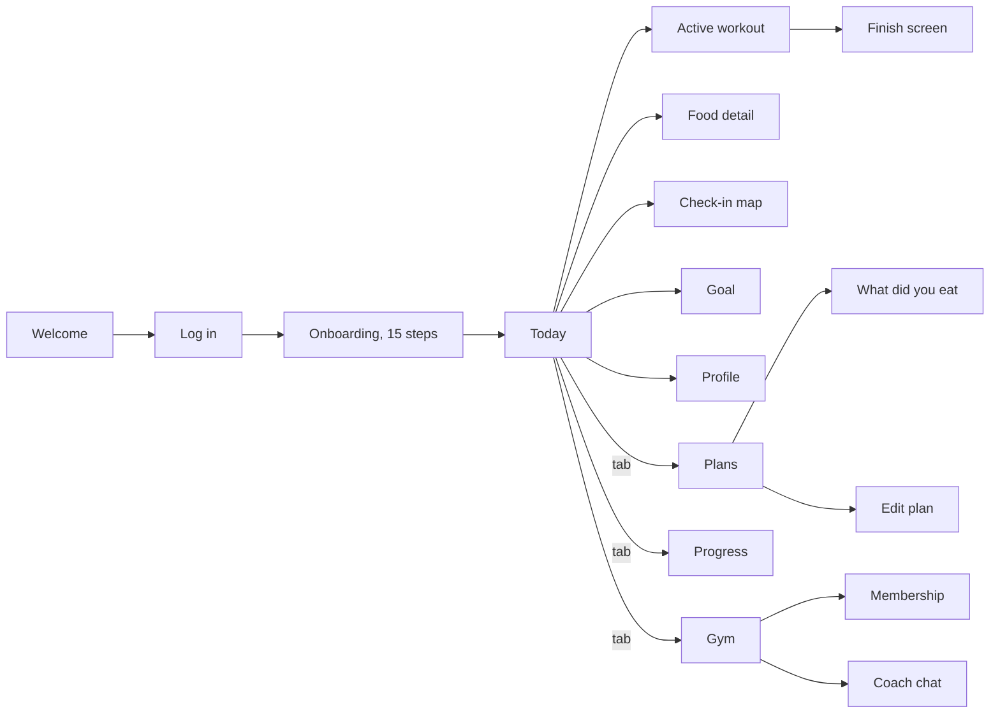

# Screen map

For the developer. Every screen of the app: where its code is, how a member gets there, where it leads, which sheets it opens, which library pieces it is built from and what data it reads. Generated from the code by `node scripts/audit/screen-map.js` (a first draft: confirm the data lists against the code before building the backend). Generated 2026-11-16.

How to read it
- **Route** is the address of the screen (Expo Router: the file under `src/app` is the route).
- **Opens from** and **Leads to** are screens that link to each other with `router.push`, `router.replace` or a link. The tab bar (Today, Plans, Progress, Gym) is on every tab screen and is not repeated.
- A screen reached from inside a sheet (for example Food detail, opened from the meal log sheet) may not appear under the screen that opens the sheet. Its **Opens from** line names the code files that link to it.
- **Library pieces** are components from `src/design-system` (docs: `docs/design-system-components.md`). The text and row primitives are left out.
- **Data it reads** is what the screen takes from the app's state. Today all of it is **sample data** (`src/lib/data.ts`) or local state; none of it comes from a server yet. The table at the end lists what a backend has to supply.

## Main journeys

Onboarding steps, in order: welcome, facility, goal, experience, schedule, age, height, weight, target, plan, health, basics, consent (asks for notifications), building, ready.

## Screens

| Screen | Route | Code | Opens from | Leads to |
|---|---|---|---|---|
| Gym | `/gym` | `src/app/(tabs)/gym.tsx` | Tab bar: Gym | [Membership](#membership), [Attendance](#attendance), [Assessments](#assessments), [Coach](#coach), [Coach chat](#coach-chat), [PT package](#pt-package), [/gym/sessions](#gym-sessions), [/gym/membership-detail](#gym-membership-detail) |
| Today | `/` | `src/app/(tabs)/index.tsx` | Tab bar: Today | [Your goal](#your-goal), [Confirm session](#confirm-session), [Plans](#plans), [Metric detail](#metric-detail), [Log weight](#log-weight), [Connected apps](#connected-apps), [Coach](#coach), [Active workout](#active-workout), [Progress](#progress), [Membership](#membership), [Log height](#log-height), [Check-in map](#check-in-map), [/profile/waiver](#profile-waiver), [Streaks and badges](#streaks-and-badges) |
| Plans | `/plans` | `src/app/(tabs)/plans.tsx` | Tab bar: Plans | [What changed](#what-changed), [Exercise](#exercise), [Ask coach](#ask-coach), [Active workout](#active-workout), [/plans/entries](#plans-entries), [Food detail](#food-detail), [What did you eat?](#what-did-you-eat) |
| Progress | `/progress` | `src/app/(tabs)/progress.tsx` | Tab bar: Progress | [Lift detail](#lift-detail), [Photos](#photos), [Metric detail](#metric-detail), [Streaks and badges](#streaks-and-badges), [/progress/muscles](#progress-muscles) |
| Check-in map | `/checkin` | `src/app/checkin.tsx` | From features/today/CheckInBar | [Active workout](#active-workout) |
| Coach | `/coach` | `src/app/coach.tsx` | From gym, gym/chat, features/gym/sheets, features/today/WorkoutCard | [Assessments](#assessments), [Plans](#plans), [Coach chat](#coach-chat) |
| Exercise search | `/exercise-search` | `src/app/exercise-search.tsx` | From features/workout/WorkoutSheets | [Active workout](#active-workout), [Coach chat](#coach-chat), [Plans](#plans) |
| /food-library | `/food-library` | `src/app/food-library.tsx` | From log-chat, features/today/AteSomethingElse | none found |
| Food detail | `/food` | `src/app/food.tsx` | From features/plans/DietPlan, features/plans/Sheets, features/today/LogMealsSheet | [Coach chat](#coach-chat) |
| Your goal | `/goal-detail` | `src/app/goal-detail.tsx` | From design-system/patterns/GoalCard, features/today/TopCards | [Progress](#progress), [Change goal](#change-goal), [Assessments](#assessments) |
| Change goal | `/goal` | `src/app/goal.tsx` | From goal-detail | [Plans](#plans) |
| /gym/assessment | `/gym/assessment` | `src/app/gym/assessment.tsx` | From gym/assessments | none found |
| Assessments | `/gym/assessments` | `src/app/gym/assessments.tsx` | From gym, coach, goal-detail | [/gym/assessment](#gym-assessment) |
| Attendance | `/gym/attendance` | `src/app/gym/attendance.tsx` | From gym | none found |
| Coach chat | `/gym/chat` | `src/app/gym/chat.tsx` | From gym, gym/pt, features/coach/coach.ts | [Gym](#gym), [Coach](#coach) |
| Confirm session | `/gym/confirm` | `src/app/gym/confirm.tsx` | From gym/session, features/today/ForYou, features/today/TopCards | [/gym/sessions](#gym-sessions), [Coach](#coach) |
| /gym/membership-detail | `/gym/membership-detail` | `src/app/gym/membership-detail.tsx` | From gym/membership | none found |
| Membership | `/gym/membership` | `src/app/gym/membership.tsx` | From gym, features/today/ForYou, features/today/PaymentBanner | [/gym/membership-detail](#gym-membership-detail) |
| /gym/payments | `/gym/payments` | `src/app/gym/payments.tsx` | Direct link | none found |
| PT package | `/gym/pt` | `src/app/gym/pt.tsx` | From gym | [Coach chat](#coach-chat), [/gym/sessions](#gym-sessions) |
| /gym/session | `/gym/session` | `src/app/gym/session.tsx` | From gym/sessions | [Confirm session](#confirm-session), [Coach](#coach) |
| /gym/sessions | `/gym/sessions` | `src/app/gym/sessions.tsx` | From gym, gym/confirm, gym/pt | [/gym/session](#gym-session), [Your goal](#your-goal), [Confirm session](#confirm-session), [Plans](#plans) |
| Entry redirect | `/` | `src/app/index.tsx` | App start: sends the member to Welcome, Login or Today | [Welcome](#welcome), [Onboarding (frame)](#onboarding-frame) |
| /log-chat | `/log-chat` | `src/app/log-chat.tsx` | From features/today/AteSomethingElse | [/food-library](#food-library) |
| Log height | `/log-height` | `src/app/log-height.tsx` | From profile/details, features/today/ForYou | [Metric detail](#metric-detail) |
| Log weight | `/log-weight` | `src/app/log-weight.tsx` | From profile/details, progress/metric, features/reminders/PushBanner, features/today/ForYou | [Metric detail](#metric-detail) |
| Log in | `/login` | `src/app/login.tsx` | From onboarding, welcome, features/shell/sheets | [Welcome](#welcome) |
| Notifications | `/notifications` | `src/app/notifications.tsx` | From components/GymHeader | none found |
| Onboarding (frame) | `/onboarding` | `src/app/onboarding.tsx` | From _layout, index, web/WebFrame | [Log in](#log-in), [Metric detail](#metric-detail) |
| Ask coach | `/plans/ask` | `src/app/plans/ask.tsx` | From plans/edit, features/plans/Sheets, features/plans/WorkoutPlan | [Plans](#plans) |
| Create a workout | `/plans/create` | `src/app/plans/create.tsx` | From features/plans/openers.ts | [Ask coach](#ask-coach), [/plans/entries](#plans-entries), [Exercise](#exercise), [Food detail](#food-detail), [What did you eat?](#what-did-you-eat), [Plans](#plans) |
| Edit plan | `/plans/edit` | `src/app/plans/edit.tsx` | From features/plans/openers.ts | [What did you eat?](#what-did-you-eat), [Ask coach](#ask-coach), [/plans/entries](#plans-entries), [Exercise](#exercise), [Food detail](#food-detail), [Plans](#plans), [Create a workout](#create-a-workout) |
| /plans/entries | `/plans/entries` | `src/app/plans/entries.tsx` | From features/plans/Sheets, features/plans/WorkoutPlan | [Plans](#plans) |
| Exercise | `/plans/exercise` | `src/app/plans/exercise.tsx` | From features/plans/Sheets, features/plans/WorkoutPlan | [Coach chat](#coach-chat), [Plans](#plans) |
| Workout history | `/plans/history` | `src/app/plans/history.tsx` | Direct link | [Ask coach](#ask-coach), [/plans/entries](#plans-entries), [Exercise](#exercise), [Food detail](#food-detail), [What did you eat?](#what-did-you-eat), [Plans](#plans) |
| What did you eat? | `/plans/log` | `src/app/plans/log.tsx` | From plans/edit, features/plans/DietPlan, features/plans/Sheets | [Plans](#plans) |
| What changed | `/plans/updated` | `src/app/plans/updated.tsx` | From features/plans/WorkoutPlan | [Plans](#plans) |
| Appearance | `/profile/appearance` | `src/app/profile/appearance.tsx` | Direct link | none found |
| Delete account | `/profile/delete` | `src/app/profile/delete.tsx` | Direct link | none found |
| My details | `/profile/details` | `src/app/profile/details.tsx` | Direct link | [Log height](#log-height), [Log weight](#log-weight), [Metric detail](#metric-detail) |
| Export my data | `/profile/export` | `src/app/profile/export.tsx` | Direct link | none found |
| Connected apps | `/profile/health` | `src/app/profile/health.tsx` | From features/today/Trackers | none found |
| Help and support | `/profile/help` | `src/app/profile/help.tsx` | Direct link | none found |
| Profile | `/profile` | `src/app/profile/index.tsx` | From components/GymHeader | [Join a programme](#join-a-programme), [Metric detail](#metric-detail), [Log weight](#log-weight), [Connected apps](#connected-apps), [Log in](#log-in) |
| Join a programme | `/profile/join` | `src/app/profile/join.tsx` | From profile/index, features/shell/Switcher | none found |
| /profile/language | `/profile/language` | `src/app/profile/language.tsx` | Direct link | none found |
| Notification settings | `/profile/notifications` | `src/app/profile/notifications.tsx` | Direct link | none found |
| /profile/preferences | `/profile/preferences` | `src/app/profile/preferences.tsx` | Direct link | none found |
| Privacy | `/profile/privacy` | `src/app/profile/privacy.tsx` | Direct link | none found |
| /profile/sound | `/profile/sound` | `src/app/profile/sound.tsx` | Direct link | none found |
| Tracker designs | `/profile/tracker-designs` | `src/app/profile/tracker-designs.tsx` | Direct link | [Metric detail](#metric-detail), [Log weight](#log-weight), [Connected apps](#connected-apps) |
| Quick trackers | `/profile/trackers` | `src/app/profile/trackers.tsx` | Direct link | none found |
| Units and detail | `/profile/units` | `src/app/profile/units.tsx` | Direct link | none found |
| /profile/waiver | `/profile/waiver` | `src/app/profile/waiver.tsx` | From features/profile/WaiverCard | none found |
| Goal (progress) | `/progress/goal` | `src/app/progress/goal.tsx` | Direct link | [Plans](#plans) |
| Lift detail | `/progress/lift` | `src/app/progress/lift.tsx` | From progress | none found |
| Metric detail | `/progress/metric` | `src/app/progress/metric.tsx` | From progress, profile/index, features/body/BodyLog, features/today/StepsCards | [Log weight](#log-weight), [Connected apps](#connected-apps) |
| /progress/muscles | `/progress/muscles` | `src/app/progress/muscles.tsx` | From features/progress/MusclesCard | none found |
| Photos | `/progress/photos` | `src/app/progress/photos.tsx` | From progress | none found |
| Streaks and badges | `/progress/streaks` | `src/app/progress/streaks.tsx` | From progress, features/streak/StreakChip | none found |
| Welcome | `/welcome` | `src/app/welcome.tsx` | From _layout, index, login | [Log in](#log-in) |
| Active workout | `/workout` | `src/app/workout.tsx` | From checkin, exercise-search, features/plans/WorkoutPlan, features/today/CheckInBar | [Coach chat](#coach-chat), [Exercise search](#exercise-search) |

## Each screen in detail

### Gym

- Route `/gym`, code `src/app/(tabs)/gym.tsx`
- Opens from: [Coach chat](#coach-chat)
- Leads to: [Membership](#membership), [Attendance](#attendance), [Assessments](#assessments), [Coach](#coach), [Coach chat](#coach-chat), [PT package](#pt-package), [/gym/sessions](#gym-sessions), [/gym/membership-detail](#gym-membership-detail)
- Sheets it opens: none
- Library pieces: `FadeIn`, `CardEdge`, `Button`, `Pressy`, `StatusDot`, `IconBadge`, `Chip`
- Data it reads: app state `onBreak`, `chat`, `ptLeft`, `membership`, `offline`, `assess`; profile none; screen stores `gymStore`; sample data none

### Today

- Route `/`, code `src/app/(tabs)/index.tsx`
- Opens from: Tab bar: Today
- Leads to: [Your goal](#your-goal), [Confirm session](#confirm-session), [Plans](#plans), [Metric detail](#metric-detail), [Log weight](#log-weight), [Connected apps](#connected-apps), [Coach](#coach), [Active workout](#active-workout), [Progress](#progress), [Membership](#membership), [Log height](#log-height), [Check-in map](#check-in-map), [/profile/waiver](#profile-waiver), [Streaks and badges](#streaks-and-badges)
- Sheets it opens: `QuickTipSheet`, `FlagSheet`, `UpdatesSheet`, `WaterSheet`, `HealthSheet`, `HealthConsentSheet`, `LogMealsSheet`, `MealLoggedSheet`, `DaySheet`, `FeedbackSheet`, `StepsSheet`
- Library pieces: `FadeIn`, `Button`, `Pressy`, `IconBadge`, `PageEnd`, `Card`, `CardEdge`, `Banner`
- Data it reads: app state `loading`, `session`, `todayVariant`, `hc`, `wearable`, `time`, `wkDone`, `wkScenario`, `ci`, `scanFails`, `min`, `ciStart`, `ciOut`, `ciExtend`, `goal`, `awayDays`, `hasGym`, `dismissed`, `water`, `weight`, `openMeal`, `ciAt`; profile `name`, `time`, `waiver`, `feedback`; screen stores `personalStore`, `todayUiStore`, `planStore`, `goalStore`, `stepsStore`, `goalV2Store`, `goalSizeStore`, `goalCardStore`, `topCardStore`, `gymStore`, `missedWkStore`, `coachStore`, `reminderStore`, `greetStore`, `pushStore`; sample data `dur`, `fmtT`, `Meal`, `MealId`, `MEALS`, `KCAL_TARGET`, `TODAY_IDX`, `WEEK`, `MACRO_TARGET`

### Plans

- Route `/plans`, code `src/app/(tabs)/plans.tsx`
- Opens from: [Today](#today), [Coach](#coach), [Exercise search](#exercise-search), [Change goal](#change-goal), [/gym/sessions](#gym-sessions), [Ask coach](#ask-coach), [Create a workout](#create-a-workout), [Edit plan](#edit-plan), [/plans/entries](#plans-entries), [Exercise](#exercise), [Workout history](#workout-history), [What did you eat?](#what-did-you-eat), [What changed](#what-changed), [Goal (progress)](#goal-progress)
- Leads to: [What changed](#what-changed), [Exercise](#exercise), [Ask coach](#ask-coach), [Active workout](#active-workout), [/plans/entries](#plans-entries), [Food detail](#food-detail), [What did you eat?](#what-did-you-eat)
- Sheets it opens: `LogPastWorkoutSheet`, `QtySheet`, `FoodActionsSheet`, `TimeSheet`, `QuickLogSheet`, `LibrarySheet`, `ResetSheet`, `NutritionSheet`, `DietSwapSheet`
- Library pieces: `FadeIn`, `Button`, `Card`, `Pressy`, `IconBadge`, `CardEdge`, `IconButton`, `ListCard`
- Data it reads: app state `coachUpdated`, `planReq`, `offline`, `scanFails`, `session`, `min`; profile `name`; screen stores none; sample data `basePlans`, `TODAY_IDX`, `KCAL_TARGET`, `MACRO_TARGET`, `MealId`, `MEALS`, `LIBRARY`, `SWAPS`, `PlanDay`, `FoodType`, `Mode`, `fmtT`

### Progress

- Route `/progress`, code `src/app/(tabs)/progress.tsx`
- Opens from: [Today](#today), [Your goal](#your-goal)
- Leads to: [Lift detail](#lift-detail), [Photos](#photos), [Metric detail](#metric-detail), [Streaks and badges](#streaks-and-badges), [/progress/muscles](#progress-muscles)
- Sheets it opens: `ProgressMenuSheet`, `CalendarSheet`, `ReportSheet`
- Library pieces: `FadeIn`, `Callout`, `IconBadge`, `ProgressSegments`, `IconButton`, `MuscleRings`, `Pressy`, `Pill`
- Data it reads: app state `weight`, `water`, `hc`, `goal`, `wearable`, `assess`; profile none; screen stores `progressStore`, `goalV2Store`, `stepsStore`, `streakStore`; sample data `KCAL_TARGET`

### Check-in map

- Route `/checkin`, code `src/app/checkin.tsx`
- Opens from: [Today](#today)
- Leads to: [Active workout](#active-workout)
- Sheets it opens: none
- Library pieces: `Button`, `FadeIn`, `IconBadge`
- Data it reads: app state `ci`, `ciStart`, `ciOut`, `ciExtend`, `ciAt`; profile none; screen stores `workoutUiStore`; sample data `fmtT`, `Ex`, `legDay`, `SetT`

### Coach

- Route `/coach`, code `src/app/coach.tsx`
- Opens from: [Gym](#gym), [Today](#today), [Coach chat](#coach-chat), [Confirm session](#confirm-session), [/gym/session](#gym-session)
- Leads to: [Assessments](#assessments), [Plans](#plans), [Coach chat](#coach-chat)
- Sheets it opens: none
- Library pieces: `Button`, `Card`, `SectionLabel`, `Pressy`, `IconBadge`
- Data it reads: app state `assess`; profile none; screen stores `coachStore`; sample data none

### Exercise search

- Route `/exercise-search`, code `src/app/exercise-search.tsx`
- Opens from: [Active workout](#active-workout)
- Leads to: [Active workout](#active-workout), [Coach chat](#coach-chat), [Plans](#plans)
- Sheets it opens: none
- Library pieces: `Pill`, `Field`, `Pressy`, `IconBadge`, `Button`
- Data it reads: app state `session`; profile none; screen stores none; sample data `LIBRARY`, `Ex`, `SetT`

### /food-library

- Route `/food-library`, code `src/app/food-library.tsx`
- Opens from: [/log-chat](#log-chat)
- Leads to: none found
- Sheets it opens: none
- Library pieces: `Field`, `IconButton`, `Option`, `FoodCard`, `Button`
- Data it reads: app state `meals`, `min`; profile none; screen stores none; sample data `CATALOG`, `CatalogItem`, `FOOD_CATS`, `FoodCat`, `MealId`, `OFTEN`, `SWAPS`, `FoodType`, `MEALS`, `Mode`, `TODAY_IDX`, `fmtT`, `dur`, `Meal`

### Food detail

- Route `/food`, code `src/app/food.tsx`
- Opens from: [Plans](#plans), [Create a workout](#create-a-workout), [Edit plan](#edit-plan), [Workout history](#workout-history)
- Leads to: [Coach chat](#coach-chat)
- Sheets it opens: `QuickLogSheet`
- Library pieces: `IconBadge`, `Card`, `Pressy`, `Chip`, `ProgressBar`, `Button`, `FadeIn`
- Data it reads: app state `meals`; profile none; screen stores none; sample data `FOOD_DB`, `FoodType`, `KCAL_TARGET`, `MACRO_TARGET`, `MealId`, `dur`, `fmtT`, `Meal`, `MEALS`

### Your goal

- Route `/goal-detail`, code `src/app/goal-detail.tsx`
- Opens from: [Today](#today), [/gym/sessions](#gym-sessions)
- Leads to: [Progress](#progress), [Change goal](#change-goal), [Assessments](#assessments)
- Sheets it opens: none
- Library pieces: `Card`, `Button`, `IconBadge`, `Pressy`, `SectionLabel`, `ProgressBar`, `TopGlow`
- Data it reads: app state `goal`, `assess`, `weight`, `water`; profile none; screen stores `goalV2Store`, `stepsStore`, `streakStore`; sample data `KCAL_TARGET`

### Change goal

- Route `/goal`, code `src/app/goal.tsx`
- Opens from: [Your goal](#your-goal)
- Leads to: [Plans](#plans)
- Sheets it opens: `DateSheet`
- Library pieces: `Card`, `Pill`, `Button`, `FadeIn`
- Data it reads: app state `goal`, `weight`; profile `goal2`; screen stores `goalV2Store`, `stepsStore`; sample data `KCAL_TARGET`

### /gym/assessment

- Route `/gym/assessment`, code `src/app/gym/assessment.tsx`
- Opens from: [Assessments](#assessments)
- Leads to: none found
- Sheets it opens: none
- Library pieces: `Chip`, `CardEdge`, `SectionLabel`, `TopGlow`, `IconBadge`
- Data it reads: app state none; profile none; screen stores none; sample data none

### Assessments

- Route `/gym/assessments`, code `src/app/gym/assessments.tsx`
- Opens from: [Gym](#gym), [Coach](#coach), [Your goal](#your-goal)
- Leads to: [/gym/assessment](#gym-assessment)
- Sheets it opens: none
- Library pieces: `IconBadge`, `Pressy`, `CardEdge`, `TopGlow`, `Card`, `Chip`
- Data it reads: app state `membership`, `chat`, `offline`, `assess`, `onBreak`; profile none; screen stores `gymStore`; sample data none

### Attendance

- Route `/gym/attendance`, code `src/app/gym/attendance.tsx`
- Opens from: [Gym](#gym)
- Leads to: none found
- Sheets it opens: none
- Library pieces: `Pressy`, `IconBadge`, `TopGlow`, `CardEdge`, `StatusDot`, `Card`, `FadeIn`
- Data it reads: app state `membership`, `chat`, `offline`, `assess`, `onBreak`; profile none; screen stores `gymStore`; sample data none

### Coach chat

- Route `/gym/chat`, code `src/app/gym/chat.tsx`
- Opens from: [Gym](#gym), [Coach](#coach), [Exercise search](#exercise-search), [Food detail](#food-detail), [PT package](#pt-package), [Exercise](#exercise), [Active workout](#active-workout)
- Leads to: [Gym](#gym), [Coach](#coach)
- Sheets it opens: `ChatOptionsSheet`, `AttachSheet`
- Library pieces: `Pressy`, `FadeIn`, `Button`, `IconButton`, `Callout`
- Data it reads: app state `chat`, `offline`, `membership`, `assess`, `onBreak`; profile none; screen stores `gymStore`, `coachStore`; sample data none

### Confirm session

- Route `/gym/confirm`, code `src/app/gym/confirm.tsx`
- Opens from: [Today](#today), [/gym/session](#gym-session), [/gym/sessions](#gym-sessions)
- Leads to: [/gym/sessions](#gym-sessions), [Coach](#coach)
- Sheets it opens: `FlagSheet`
- Library pieces: `FadeIn`, `Pressy`, `Card`, `Field`, `Button`
- Data it reads: app state `ptLeft`, `membership`, `chat`, `offline`, `assess`, `onBreak`; profile none; screen stores `gymStore`; sample data none

### /gym/membership-detail

- Route `/gym/membership-detail`, code `src/app/gym/membership-detail.tsx`
- Opens from: [Gym](#gym), [Membership](#membership)
- Leads to: none found
- Sheets it opens: none
- Library pieces: `CardEdge`, `IconBadge`, `StatusDot`, `ProgressSegments`, `Pressy`, `Chip`, `Button`
- Data it reads: app state `onBreak`, `membership`, `ptLeft`, `chat`, `offline`, `assess`; profile `name`; screen stores `gymStore`; sample data none

### Membership

- Route `/gym/membership`, code `src/app/gym/membership.tsx`
- Opens from: [Gym](#gym), [Today](#today)
- Leads to: [/gym/membership-detail](#gym-membership-detail)
- Sheets it opens: none
- Library pieces: `Chip`, `CardEdge`, `Pressy`, `TopGlow`, `Segmented`, `SectionLabel`
- Data it reads: app state `membership`, `chat`, `offline`, `assess`, `onBreak`, `ptLeft`; profile none; screen stores `gymStore`; sample data none

### /gym/payments

- Route `/gym/payments`, code `src/app/gym/payments.tsx`
- Opens from: Direct link
- Leads to: none found
- Sheets it opens: none
- Library pieces: `SubPage`, `Chip`, `Button`
- Data it reads: app state `membership`, `ptLeft`; profile `name`; screen stores none; sample data none

### PT package

- Route `/gym/pt`, code `src/app/gym/pt.tsx`
- Opens from: [Gym](#gym)
- Leads to: [Coach chat](#coach-chat), [/gym/sessions](#gym-sessions)
- Sheets it opens: none
- Library pieces: `TopGlow`, `Button`, `IconBadge`, `CardEdge`
- Data it reads: app state `ptLeft`, `goal`, `membership`, `chat`, `offline`, `assess`, `onBreak`; profile none; screen stores `gymStore`, `goalV2Store`; sample data none

### /gym/session

- Route `/gym/session`, code `src/app/gym/session.tsx`
- Opens from: [/gym/sessions](#gym-sessions)
- Leads to: [Confirm session](#confirm-session), [Coach](#coach)
- Sheets it opens: `FlagSheet`
- Library pieces: `CardEdge`, `Button`, `Pressy`, `Chip`
- Data it reads: app state `membership`, `chat`, `offline`, `assess`, `onBreak`; profile none; screen stores `gymStore`; sample data none

### /gym/sessions

- Route `/gym/sessions`, code `src/app/gym/sessions.tsx`
- Opens from: [Gym](#gym), [Confirm session](#confirm-session), [PT package](#pt-package)
- Leads to: [/gym/session](#gym-session), [Your goal](#your-goal), [Confirm session](#confirm-session), [Plans](#plans)
- Sheets it opens: `FlagSheet`, `UpdatesSheet`
- Library pieces: `Pressy`, `CardEdge`
- Data it reads: app state `hc`, `wearable`, `awayDays`, `todayVariant`, `dismissed`, `membership`, `chat`, `offline`, `assess`, `onBreak`; profile `name`; screen stores `gymStore`; sample data `KCAL_TARGET`

### Entry redirect

- Route `/`, code `src/app/index.tsx`
- Opens from: App start: sends the member to Welcome, Login or Today
- Leads to: [Welcome](#welcome), [Onboarding (frame)](#onboarding-frame)
- Sheets it opens: none
- Library pieces: none
- Data it reads: app state none; profile none; screen stores none; sample data none

### /log-chat

- Route `/log-chat`, code `src/app/log-chat.tsx`
- Opens from: From features/today/AteSomethingElse
- Leads to: [/food-library](#food-library)
- Sheets it opens: none
- Library pieces: `GrowFrame`, `IconButton`, `FadeIn`, `FoodCard`, `Button`, `Option`, `ChatBar`
- Data it reads: app state `meals`; profile none; screen stores none; sample data `KCAL_TARGET`, `MealId`, `parseFood`, `Parsed`, `SCAN_RESULT`, `dur`, `fmtT`, `Meal`, `MEALS`

### Log height

- Route `/log-height`, code `src/app/log-height.tsx`
- Opens from: [Today](#today), [My details](#my-details)
- Leads to: [Metric detail](#metric-detail)
- Sheets it opens: `WeighDateSheet`
- Library pieces: none
- Data it reads: app state `weight`; profile `weightKg`, `heightCm`; screen stores none; sample data none

### Log weight

- Route `/log-weight`, code `src/app/log-weight.tsx`
- Opens from: [Today](#today), [My details](#my-details), [Profile](#profile), [Tracker designs](#tracker-designs), [Metric detail](#metric-detail)
- Leads to: [Metric detail](#metric-detail)
- Sheets it opens: `WeighDateSheet`
- Library pieces: none
- Data it reads: app state `weight`; profile `weightKg`, `heightCm`; screen stores none; sample data none

### Log in

- Route `/login`, code `src/app/login.tsx`
- Opens from: [Onboarding (frame)](#onboarding-frame), [Profile](#profile), [Welcome](#welcome)
- Leads to: [Welcome](#welcome)
- Sheets it opens: `CountrySheet`
- Library pieces: `FadeIn`, `Button`, `Pressy`, `Field`, `Callout`
- Data it reads: app state none; profile none; screen stores none; sample data none

### Notifications

- Route `/notifications`, code `src/app/notifications.tsx`
- Opens from: From components/GymHeader
- Leads to: none found
- Sheets it opens: none
- Library pieces: `Pressy`, `FadeIn`, `Pill`, `CardEdge`, `IconBadge`
- Data it reads: app state `notifsRead`; profile none; screen stores `gymStore`; sample data none

### Onboarding (frame)

- Route `/onboarding`, code `src/app/onboarding.tsx`
- Opens from: [Today](#today)
- Leads to: [Log in](#log-in), [Metric detail](#metric-detail)
- Sheets it opens: `View`, `DateSheet`, `WeighDateSheet`
- Library pieces: `IconBadge`, `FadeIn`, `Pressy`, `Card`, `Pill`, `Button`, `Option`, `Chip`
- Data it reads: app state `goal`, `weight`; profile `exp`, `dob`, `heightCm`, `weightKg`, `photosPrivate`; screen stores `goalV2Store`, `stepsStore`; sample data `KCAL_TARGET`

### Ask coach

- Route `/plans/ask`, code `src/app/plans/ask.tsx`
- Opens from: [Plans](#plans), [Create a workout](#create-a-workout), [Edit plan](#edit-plan), [Workout history](#workout-history)
- Leads to: [Plans](#plans)
- Sheets it opens: none
- Library pieces: `Pill`, `FadeIn`, `Button`
- Data it reads: app state `offline`; profile none; screen stores none; sample data `PlanDay`, `FoodType`, `MealId`, `MEALS`, `Mode`, `TODAY_IDX`, `fmtT`

### Create a workout

- Route `/plans/create`, code `src/app/plans/create.tsx`
- Opens from: [Edit plan](#edit-plan)
- Leads to: [Ask coach](#ask-coach), [/plans/entries](#plans-entries), [Exercise](#exercise), [Food detail](#food-detail), [What did you eat?](#what-did-you-eat), [Plans](#plans)
- Sheets it opens: `LibrarySheet`, `ResetSheet`, `NutritionSheet`, `DietSwapSheet`
- Library pieces: `Button`, `Field`, `Pill`, `Card`, `Pressy`
- Data it reads: app state `offline`; profile `name`; screen stores none; sample data `PlanDay`, `basePlans`, `LIBRARY`, `MealId`, `SWAPS`, `FoodType`, `MEALS`, `Mode`, `TODAY_IDX`, `fmtT`

### Edit plan

- Route `/plans/edit`, code `src/app/plans/edit.tsx`
- Opens from: From features/plans/openers.ts
- Leads to: [What did you eat?](#what-did-you-eat), [Ask coach](#ask-coach), [/plans/entries](#plans-entries), [Exercise](#exercise), [Food detail](#food-detail), [Plans](#plans), [Create a workout](#create-a-workout)
- Sheets it opens: `DiscardSheet`, `LibrarySheet`, `EditItemSheet`, `ResetSheet`, `NutritionSheet`, `DietSwapSheet`
- Library pieces: `Button`, `Pressy`
- Data it reads: app state `offline`; profile `name`; screen stores none; sample data `basePlans`, `LIBRARY`, `MealId`, `SWAPS`, `MEALS`, `FoodType`, `Mode`, `TODAY_IDX`, `fmtT`

### /plans/entries

- Route `/plans/entries`, code `src/app/plans/entries.tsx`
- Opens from: [Plans](#plans), [Create a workout](#create-a-workout), [Edit plan](#edit-plan), [Workout history](#workout-history)
- Leads to: [Plans](#plans)
- Sheets it opens: none
- Library pieces: `AmountStepper`, `Pressy`, `CardEdge`, `Button`
- Data it reads: app state `pastLogs`; profile none; screen stores none; sample data `fmtT`, `FoodType`, `MealId`, `MEALS`, `Mode`, `TODAY_IDX`

### Exercise

- Route `/plans/exercise`, code `src/app/plans/exercise.tsx`
- Opens from: [Plans](#plans), [Create a workout](#create-a-workout), [Edit plan](#edit-plan), [Workout history](#workout-history)
- Leads to: [Coach chat](#coach-chat), [Plans](#plans)
- Sheets it opens: none
- Library pieces: `Card`, `IconButton`, `CardEdge`, `Button`
- Data it reads: app state `offline`; profile none; screen stores none; sample data `PlanDay`, `Ex`, `SetT`

### Workout history

- Route `/plans/history`, code `src/app/plans/history.tsx`
- Opens from: Direct link
- Leads to: [Ask coach](#ask-coach), [/plans/entries](#plans-entries), [Exercise](#exercise), [Food detail](#food-detail), [What did you eat?](#what-did-you-eat), [Plans](#plans)
- Sheets it opens: `HistSheet`, `LibrarySheet`, `ResetSheet`, `NutritionSheet`, `DietSwapSheet`
- Library pieces: `Card`, `Pressy`, `IconBadge`
- Data it reads: app state none; profile `name`; screen stores none; sample data `PlanDay`, `basePlans`, `LIBRARY`, `MealId`, `SWAPS`

### What did you eat?

- Route `/plans/log`, code `src/app/plans/log.tsx`
- Opens from: [Plans](#plans), [Create a workout](#create-a-workout), [Edit plan](#edit-plan), [Workout history](#workout-history)
- Leads to: [Plans](#plans)
- Sheets it opens: `TimeSheet`
- Library pieces: `FadeIn`, `Card`, `Button`, `ScanBracket`, `Pressy`, `Pill`, `IconBadge`, `Field`
- Data it reads: app state `scanFails`, `min`, `meals`; profile none; screen stores none; sample data `FoodType`, `MealId`, `MEALS`, `PlanDay`, `Mode`, `TODAY_IDX`, `fmtT`

### What changed

- Route `/plans/updated`, code `src/app/plans/updated.tsx`
- Opens from: [Plans](#plans)
- Leads to: [Plans](#plans)
- Sheets it opens: none
- Library pieces: `Card`, `FadeIn`, `Button`
- Data it reads: app state `session`; profile none; screen stores none; sample data `TODAY_IDX`, `PlanDay`, `FoodType`, `MealId`, `MEALS`, `Mode`, `fmtT`

### Appearance

- Route `/profile/appearance`, code `src/app/profile/appearance.tsx`
- Opens from: Direct link
- Leads to: none found
- Sheets it opens: none
- Library pieces: `Pressy`, `IconBadge`
- Data it reads: app state none; profile none; screen stores none; sample data none

### Delete account

- Route `/profile/delete`, code `src/app/profile/delete.tsx`
- Opens from: Direct link
- Leads to: none found
- Sheets it opens: none
- Library pieces: `Button`, `Callout`, `Field`
- Data it reads: app state none; profile none; screen stores none; sample data none

### My details

- Route `/profile/details`, code `src/app/profile/details.tsx`
- Opens from: Direct link
- Leads to: [Log height](#log-height), [Log weight](#log-weight), [Metric detail](#metric-detail)
- Sheets it opens: `PhotoSheet`, `ChangePhoneSheet`, `ChangeEmailSheet`, `GenderSheet`, `DobSheet`, `WeighDateSheet`
- Library pieces: `Button`, `Field`, `Pressy`, `CardEdge`, `FadeIn`
- Data it reads: app state `weight`; profile `email`, `dob`, `weightKg`, `heightCm`, `gender`; screen stores none; sample data none

### Export my data

- Route `/profile/export`, code `src/app/profile/export.tsx`
- Opens from: Direct link
- Leads to: none found
- Sheets it opens: none
- Library pieces: `FadeIn`, `ProgressBar`, `Button`
- Data it reads: app state none; profile none; screen stores none; sample data none

### Connected apps

- Route `/profile/health`, code `src/app/profile/health.tsx`
- Opens from: [Today](#today), [Profile](#profile), [Tracker designs](#tracker-designs), [Metric detail](#metric-detail)
- Leads to: none found
- Sheets it opens: `View`
- Library pieces: `Button`, `IconBadge`, `Card`, `Pressy`
- Data it reads: app state `hc`, `wearable`; profile none; screen stores none; sample data none

### Help and support

- Route `/profile/help`, code `src/app/profile/help.tsx`
- Opens from: Direct link
- Leads to: none found
- Sheets it opens: none
- Library pieces: `Pressy`, `FadeIn`, `Button`
- Data it reads: app state none; profile none; screen stores none; sample data none

### Profile

- Route `/profile`, code `src/app/profile/index.tsx`
- Opens from: From components/GymHeader
- Leads to: [Join a programme](#join-a-programme), [Metric detail](#metric-detail), [Log weight](#log-weight), [Connected apps](#connected-apps), [Log in](#log-in)
- Sheets it opens: `LogoutSheet`, `FeedbackSheet`, `StepsSheet`, `WaterSheet`, `HealthSheet`, `HealthConsentSheet`
- Library pieces: `Button`, `Pressy`, `CardEdge`, `Chip`, `FadeIn`
- Data it reads: app state `hasGym`, `hc`, `water`, `min`, `weight`, `wearable`, `goal`; profile `language`, `timer`, `feedback`; screen stores `stepsStore`, `personalStore`, `goalV2Store`; sample data none

### Join a programme

- Route `/profile/join`, code `src/app/profile/join.tsx`
- Opens from: [Profile](#profile)
- Leads to: none found
- Sheets it opens: `JoinConsentSheet`
- Library pieces: `FadeIn`, `Field`, `Button`
- Data it reads: app state none; profile none; screen stores none; sample data none

### /profile/language

- Route `/profile/language`, code `src/app/profile/language.tsx`
- Opens from: Direct link
- Leads to: none found
- Sheets it opens: none
- Library pieces: `CardEdge`, `Pressy`
- Data it reads: app state none; profile `language`; screen stores none; sample data none

### Notification settings

- Route `/profile/notifications`, code `src/app/profile/notifications.tsx`
- Opens from: Direct link
- Leads to: none found
- Sheets it opens: none
- Library pieces: `FadeIn`, `Button`
- Data it reads: app state `min`, `water`, `hc`; profile `notifications`; screen stores `reminderStore`, `goalCardStore`; sample data `fmtT`, `MEALS`

### /profile/preferences

- Route `/profile/preferences`, code `src/app/profile/preferences.tsx`
- Opens from: Direct link
- Leads to: none found
- Sheets it opens: none
- Library pieces: `Pill`, `Button`, `Card`, `FadeIn`, `NoteField`
- Data it reads: app state none; profile `gender`; screen stores none; sample data none

### Privacy

- Route `/profile/privacy`, code `src/app/profile/privacy.tsx`
- Opens from: Direct link
- Leads to: none found
- Sheets it opens: none
- Library pieces: none
- Data it reads: app state none; profile none; screen stores none; sample data none

### /profile/sound

- Route `/profile/sound`, code `src/app/profile/sound.tsx`
- Opens from: Direct link
- Leads to: none found
- Sheets it opens: none
- Library pieces: `CardEdge`, `Button`
- Data it reads: app state none; profile `timer`; screen stores none; sample data none

### Tracker designs

- Route `/profile/tracker-designs`, code `src/app/profile/tracker-designs.tsx`
- Opens from: Direct link
- Leads to: [Metric detail](#metric-detail), [Log weight](#log-weight), [Connected apps](#connected-apps)
- Sheets it opens: `StepsSheet`, `WaterSheet`, `HealthSheet`, `HealthConsentSheet`
- Library pieces: `Pressy`, `IconBadge`
- Data it reads: app state `hc`, `water`, `min`, `weight`, `wearable`; profile none; screen stores `stepsStore`, `designStore`, `personalStore`; sample data none

### Quick trackers

- Route `/profile/trackers`, code `src/app/profile/trackers.tsx`
- Opens from: Direct link
- Leads to: none found
- Sheets it opens: none
- Library pieces: `FadeIn`
- Data it reads: app state `hc`, `wearable`; profile none; screen stores none; sample data none

### Units and detail

- Route `/profile/units`, code `src/app/profile/units.tsx`
- Opens from: Direct link
- Leads to: none found
- Sheets it opens: none
- Library pieces: `Pill`
- Data it reads: app state none; profile none; screen stores none; sample data none

### /profile/waiver

- Route `/profile/waiver`, code `src/app/profile/waiver.tsx`
- Opens from: [Today](#today)
- Leads to: none found
- Sheets it opens: `SignSheet`
- Library pieces: `Button`, `Chip`, `CardEdge`, `TopGlow`, `IconBadge`, `Pressy`
- Data it reads: app state none; profile `waiver`; screen stores none; sample data none

### Goal (progress)

- Route `/progress/goal`, code `src/app/progress/goal.tsx`
- Opens from: Direct link
- Leads to: [Plans](#plans)
- Sheets it opens: `DateSheet`
- Library pieces: `Pill`, `Button`, `Card`, `FadeIn`
- Data it reads: app state `goal`, `hc`, `assess`; profile none; screen stores `goalV2Store`, `stepsStore`, `progressStore`; sample data `KCAL_TARGET`

### Lift detail

- Route `/progress/lift`, code `src/app/progress/lift.tsx`
- Opens from: [Progress](#progress)
- Leads to: none found
- Sheets it opens: none
- Library pieces: `Segmented`, `FadeIn`, `TopGlow`, `Pressy`
- Data it reads: app state `goal`, `hc`, `assess`; profile none; screen stores `progressStore`, `goalV2Store`; sample data none

### Metric detail

- Route `/progress/metric`, code `src/app/progress/metric.tsx`
- Opens from: [Today](#today), [Progress](#progress), [Log height](#log-height), [Log weight](#log-weight), [Onboarding (frame)](#onboarding-frame), [My details](#my-details), [Profile](#profile), [Tracker designs](#tracker-designs)
- Leads to: [Log weight](#log-weight), [Connected apps](#connected-apps)
- Sheets it opens: `StepsSheet`, `WaterSheet`, `QuickLogSheet`, `ManualLogSheet`, `HealthSheet`, `HealthConsentSheet`, `CalendarSheet`
- Library pieces: `Button`, `Card`, `IconBadge`, `FadeIn`, `Callout`, `Field`
- Data it reads: app state `weight`, `water`, `hc`, `min`, `wearable`, `goal`, `assess`, `membership`, `ptLeft`; profile none; screen stores `progressStore`, `stepsStore`, `personalStore`, `goalV2Store`; sample data `KCAL_TARGET`, `dur`, `fmtT`, `Meal`, `MealId`, `MEALS`

### /progress/muscles

- Route `/progress/muscles`, code `src/app/progress/muscles.tsx`
- Opens from: [Progress](#progress)
- Leads to: none found
- Sheets it opens: `CalendarSheet`
- Library pieces: `TopGlow`, `MuscleRings`, `MuscleThumb`
- Data it reads: app state none; profile none; screen stores `progressStore`; sample data none

### Photos

- Route `/progress/photos`, code `src/app/progress/photos.tsx`
- Opens from: [Progress](#progress)
- Leads to: none found
- Sheets it opens: none
- Library pieces: `Button`, `Pressy`, `FadeIn`, `IconBadge`, `TopGlow`
- Data it reads: app state `goal`, `hc`, `assess`; profile none; screen stores `progressStore`, `goalV2Store`; sample data none

### Streaks and badges

- Route `/progress/streaks`, code `src/app/progress/streaks.tsx`
- Opens from: [Today](#today), [Progress](#progress)
- Leads to: none found
- Sheets it opens: none
- Library pieces: `CardEdge`, `SectionLabel`, `Card`, `Callout`, `IconBadge`, `FadeIn`
- Data it reads: app state `wkScenario`, `goal`; profile none; screen stores `streakStore`, `goalV2Store`; sample data none

### Welcome

- Route `/welcome`, code `src/app/welcome.tsx`
- Opens from: [Today](#today), [Log in](#log-in)
- Leads to: [Log in](#log-in)
- Sheets it opens: none
- Library pieces: `FadeIn`, `ProgressSegments`, `Pressy`, `Button`
- Data it reads: app state none; profile none; screen stores none; sample data none

### Active workout

- Route `/workout`, code `src/app/workout.tsx`
- Opens from: [Today](#today), [Plans](#plans), [Check-in map](#check-in-map), [Exercise search](#exercise-search)
- Leads to: [Coach chat](#coach-chat), [Exercise search](#exercise-search)
- Sheets it opens: `SwapSheet`, `SetMenuSheet`, `AddExerciseSheet`, `FormTipsSheet`, `FinishConfirmSheet`, `WkMenuSheet`
- Library pieces: `Button`, `FadeIn`, `Pressy`, `IconButton`, `Pill`, `IconBadge`, `Card`, `Stepper`
- Data it reads: app state `session`, `hc`, `wearable`, `hasGym`; profile none; screen stores `workoutUiStore`; sample data `COOLDOWN`, `WARMUP`, `Ex`, `SetT`, `legDay`, `ListItem`, `LIBRARY`, `Mode`

## What a backend has to supply

Everything below is made up or kept on the phone today. The three tables show what the screens read, with the screens that read it. They are the starting list for the API.

### App state (`src/lib/domain.tsx`)

The member's day: time of day, workout session, meals eaten, check-in, membership, goal and so on. Defined in `src/lib/domain.tsx` (type `Domain`).

| Field | Screens | Which |
|---|---|---|
| `assess` | 17 | Gym, Progress, Coach, Your goal, Assessments, Attendance, ... |
| `offline` | 15 | Gym, Plans, Assessments, Attendance, Coach chat, Confirm session, ... |
| `hc` | 13 | Today, Progress, /gym/sessions, Connected apps, Profile, Notification settings, ... |
| `goal` | 12 | Today, Progress, Your goal, Change goal, PT package, Onboarding (frame), ... |
| `membership` | 12 | Gym, Assessments, Attendance, Coach chat, Confirm session, /gym/membership-detail, ... |
| `weight` | 11 | Today, Progress, Your goal, Change goal, Log height, Log weight, ... |
| `chat` | 10 | Gym, Assessments, Attendance, Coach chat, Confirm session, /gym/membership-detail, ... |
| `onBreak` | 10 | Gym, Assessments, Attendance, Coach chat, Confirm session, /gym/membership-detail, ... |
| `wearable` | 9 | Today, Progress, /gym/sessions, Connected apps, Profile, Tracker designs, ... |
| `min` | 8 | Today, Plans, /food-library, What did you eat?, Profile, Notification settings, ... |
| `ptLeft` | 7 | Gym, Confirm session, /gym/membership-detail, Membership, /gym/payments, PT package, ... |
| `water` | 7 | Today, Progress, Your goal, Profile, Notification settings, Tracker designs, ... |
| `session` | 5 | Today, Plans, Exercise search, What changed, Active workout |
| `meals` | 4 | /food-library, Food detail, /log-chat, What did you eat? |
| `hasGym` | 3 | Today, Profile, Active workout |
| `scanFails` | 3 | Today, Plans, What did you eat? |
| `awayDays` | 2 | Today, /gym/sessions |
| `ci` | 2 | Today, Check-in map |
| `ciAt` | 2 | Today, Check-in map |
| `ciExtend` | 2 | Today, Check-in map |
| `ciOut` | 2 | Today, Check-in map |
| `ciStart` | 2 | Today, Check-in map |
| `dismissed` | 2 | Today, /gym/sessions |
| `todayVariant` | 2 | Today, /gym/sessions |
| `wkScenario` | 2 | Today, Streaks and badges |
| `coachUpdated` | 1 | Plans |
| `loading` | 1 | Today |
| `notifsRead` | 1 | Notifications |
| `openMeal` | 1 | Today |
| `pastLogs` | 1 | /plans/entries |
| `planReq` | 1 | Plans |
| `time` | 1 | Today |
| `wkDone` | 1 | Today |

### Screen stores (module state)

Small stores for one area (plans, progress, gym, coach, streak, reminders). Defined next to their feature.

| Store | Screens | Which |
|---|---|---|
| `goalV2Store` | 12 | Today, Progress, Your goal, Change goal, PT package, Onboarding (frame), ... |
| `gymStore` | 12 | Gym, Today, Assessments, Attendance, Coach chat, Confirm session, ... |
| `stepsStore` | 9 | Today, Progress, Your goal, Change goal, Onboarding (frame), Profile, ... |
| `progressStore` | 6 | Progress, Goal (progress), Lift detail, Metric detail, /progress/muscles, Photos |
| `personalStore` | 4 | Today, Profile, Tracker designs, Metric detail |
| `coachStore` | 3 | Today, Coach, Coach chat |
| `streakStore` | 3 | Progress, Your goal, Streaks and badges |
| `goalCardStore` | 2 | Today, Notification settings |
| `reminderStore` | 2 | Today, Notification settings |
| `workoutUiStore` | 2 | Check-in map, Active workout |
| `designStore` | 1 | Tracker designs |
| `goalSizeStore` | 1 | Today |
| `goalStore` | 1 | Today |
| `greetStore` | 1 | Today |
| `missedWkStore` | 1 | Today |
| `planStore` | 1 | Today |
| `pushStore` | 1 | Today |
| `todayUiStore` | 1 | Today |
| `topCardStore` | 1 | Today |

### Sample data (`src/lib/data.ts`)

Made-up content: meals, food details, workouts, plans, the weekly strip, assessments. A real app loads these from the server.

| Export | Screens | Which |
|---|---|---|
| `fmtT` | 14 | Today, Plans, Check-in map, /food-library, Food detail, /log-chat, ... |
| `MealId` | 13 | Today, Plans, /food-library, Food detail, /log-chat, Ask coach, ... |
| `MEALS` | 13 | Today, Plans, /food-library, Food detail, /log-chat, Ask coach, ... |
| `KCAL_TARGET` | 11 | Today, Plans, Progress, Food detail, Your goal, Change goal, ... |
| `FoodType` | 9 | Plans, /food-library, Food detail, Ask coach, Create a workout, Edit plan, ... |
| `Mode` | 9 | Plans, /food-library, Ask coach, Create a workout, Edit plan, /plans/entries, ... |
| `TODAY_IDX` | 9 | Today, Plans, /food-library, Ask coach, Create a workout, Edit plan, ... |
| `PlanDay` | 7 | Plans, Ask coach, Create a workout, Exercise, Workout history, What did you eat?, ... |
| `LIBRARY` | 6 | Plans, Exercise search, Create a workout, Edit plan, Workout history, Active workout |
| `dur` | 5 | Today, /food-library, Food detail, /log-chat, Metric detail |
| `Meal` | 5 | Today, /food-library, Food detail, /log-chat, Metric detail |
| `SWAPS` | 5 | Plans, /food-library, Create a workout, Edit plan, Workout history |
| `basePlans` | 4 | Plans, Create a workout, Edit plan, Workout history |
| `Ex` | 4 | Check-in map, Exercise search, Exercise, Active workout |
| `SetT` | 4 | Check-in map, Exercise search, Exercise, Active workout |
| `MACRO_TARGET` | 3 | Today, Plans, Food detail |
| `legDay` | 2 | Check-in map, Active workout |
| `CATALOG` | 1 | /food-library |
| `CatalogItem` | 1 | /food-library |
| `COOLDOWN` | 1 | Active workout |
| `FOOD_CATS` | 1 | /food-library |
| `FOOD_DB` | 1 | Food detail |
| `FoodCat` | 1 | /food-library |
| `ListItem` | 1 | Active workout |
| `OFTEN` | 1 | /food-library |
| `Parsed` | 1 | /log-chat |
| `parseFood` | 1 | /log-chat |
| `SCAN_RESULT` | 1 | /log-chat |
| `WARMUP` | 1 | Active workout |
| `WEEK` | 1 | Today |
